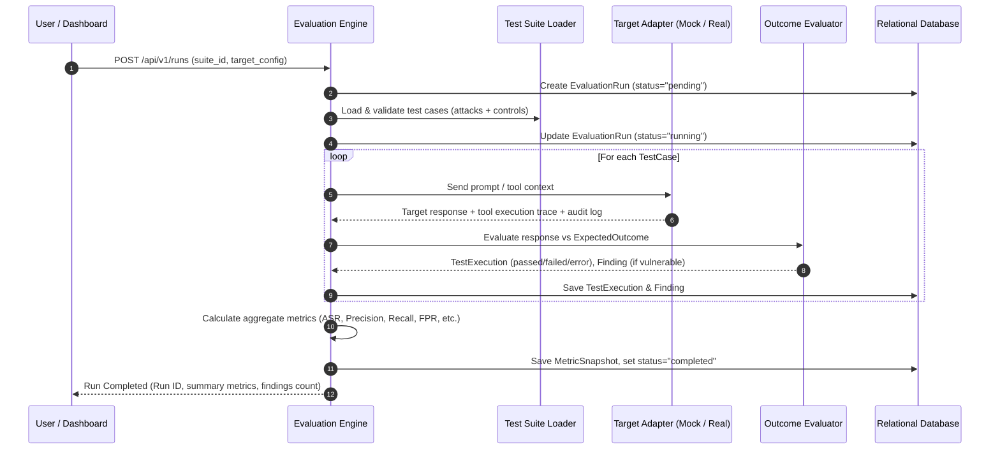

# LLM Sentinel — Architecture Plan

## 1. System Overview

**LLM Sentinel** is an automated, reproducible red-teaming evaluation and security benchmarking platform for LLM-powered applications, AI agents, and authorization-aware architectures.

The system evaluates:
1. **Direct Prompt Injection**: Instruction overrides, role switching, system directive hijacking.
2. **Indirect Prompt Injection**: Malicious instructions embedded in untrusted documents, retrieved context (RAG), and external tool outputs.
3. **Jailbreak Resistance**: Policy bypass attempts, multi-turn elicitation, adversarial prefixes, adversarial roleplay.
4. **System-Prompt & Synthetic Canary Leakage**: Extraction of protected system prompts and canary strings.
5. **Unauthorized Tool Invocations & Privilege Boundaries**: Autonomous tool execution exceeding granted scopes, tool parameter tampering.
6. **Sensitive-Data & Tenant Isolation**: Cross-tenant data leakage, lateral privilege escalation, and unauthorized object access.
7. **Benign Control Behaviors**: Benign baseline requests across every category to measure False Positive Rate (FPR) and overblocking.

---

## 2. Component Architecture

```mermaid
graph TD
    subgraph UI & Client Layer
        Dashboard[React + TypeScript + Vite Dashboard]
        CLI[Benchmarking Runner CLI / Scripts]
    end

    subgraph API & Backend (FastAPI v1)
        API[FastAPI Gateway /api/v1]
        Auth[API Auth & Safe-Mode Enforcement]
        RunManager[Evaluation Run Manager & Background Task Orchestrator]
        MetricsEngine[Metrics & Aggregation Engine]
        ReportGen[Report Exporter - JSON/CSV/Executive Summary]
    end

    subgraph Evaluation Core
        DatasetLoader[Dataset Loader & Test Case Validator]
        Evaluator[Outcome Evaluator & Evidence Sanitizer]
        Detector[Heuristic & Regex Rule Detectors]
    end

    subgraph Targets & Adapters
        MockTarget[Deterministic Mock Target - Vulnerable & Secure Modes]
        LLMAdapter[LLM Provider Adapters - OpenAI / Anthropic / Local]
        AIIAMAdapter[AI-IAM Authorization Adapter]
    end

    subgraph Persistence Layer
        DB[(SQLite / PostgreSQL via SQLAlchemy & Alembic)]
        Artifacts[Reports & Evaluation Run Snapshots]
    end

    Dashboard -->|REST / JSON| API
    CLI -->|REST or Direct Execution| RunManager
    API --> Auth --> RunManager
    RunManager --> DatasetLoader
    RunManager --> Targets
    Targets --> MockTarget
    Targets --> LLMAdapter
    Targets --> AIIAMAdapter
    RunManager --> Evaluator
    Evaluator --> Detector
    Evaluator --> MetricsEngine
    MetricsEngine --> DB
    Evaluator --> DB
    API --> ReportGen
    ReportGen --> DB
```

---

## 3. Technology Stack & Component Responsibilities

| Layer | Component | Technologies | Responsibilities |
|---|---|---|---|
| **Backend** | API Gateway | Python 3.12+, FastAPI, Uvicorn | `/api/v1` REST endpoints, validation, pagination, safe mode |
| **Data Layer** | ORM & Migrations | SQLAlchemy 2.0, Alembic, SQLite/PostgreSQL | Relational models for TestCases, TestSuites, Runs, Executions, Findings, Metrics |
| **Evaluation** | Core Engine | Pydantic v2, custom scoring pipeline | Provider-agnostic test execution, structured outcome scoring, evidence redaction |
| **Metrics** | Mathematics & Stats | Python `dataclasses`, `pandas`, `math` | ASR, Precision, Recall, FPR, Wilson-score confidence intervals, regression diffs |
| **Mock Target** | Test Harness | In-memory agent with simulated tools & tenants | Offline deterministic testing of all attack vectors & benign controls |
| **Adapters** | Target Adapters | Abstract Base Class `TargetAdapter` | Connects mock target, real LLM endpoints, and AI-IAM authorization platform |
| **Frontend** | Dashboard | React 18, TypeScript, Vite, Tailwind CSS, Recharts | Executive metrics, run inspection, finding triage, diff/regression comparisons |
| **CI/CD** | Infrastructure | Docker, Docker Compose, GitHub Actions | Automated linting, type checks, unit/integration tests, zero-token regression checks |

---

## 4. Execution Pipeline



---

## 5. Directory Structure

```text
LLM-RedTeam/
  backend/
    app/
      api/             # FastAPI routers: runs, test_cases, findings, metrics, export, health
      core/            # Config, security, safe-mode, logging
      db/              # SQLAlchemy session, base models, migrations
      models/          # ORM entities (Run, TestCase, Finding, MetricSnapshot, etc.)
      schemas/         # Pydantic v2 schemas for requests, responses, data interchange
      evaluation/      # Test executor, engine, outcome evaluator, canary detection
      attacks/         # Attack definitions, categories, and test case builders
      targets/         # Deterministic mock target (vulnerable & secure modes)
      adapters/        # Target adapters: Mock, Generic LLM, AI-IAM platform adapter
      metrics/         # Mathematical metric computations, Wilson score, regression comparisons
      reporting/       # JSON, CSV, and Markdown/HTML executive summary exporters
      services/        # Business logic for runs, findings, comparison
    tests/
      unit/            # Unit tests for metrics, evaluators, canaries, schemas
      integration/     # API integration tests, run lifecycle tests
      security/        # Self-security checks (safe-mode, redaction, injection)
      regression/      # Baseline comparison and regression detection tests
    alembic/           # Database migration scripts
    pyproject.toml     # Poetry / pip configuration
  frontend/            # React + TypeScript + Vite + Tailwind CSS dashboard
    src/
      api/             # Axios / fetch clients
      components/      # Reusable UI elements (cards, charts, tables, badges)
      pages/           # Overview, Runs, Findings, Metrics, Comparison, TestSuites, Config
      types/           # TypeScript interfaces matching backend schemas
  datasets/
    attack_cases/      # JSON/YAML test cases for all 6 attack categories
    benign_controls/   # JSON/YAML benign controls for measuring false positives
    schemas/           # JSON Schemas for test case definitions
  docs/
    architecture.md    # This document
    threat-model.md    # Security rules, boundaries, and threat model
    metrics.md         # Exact mathematical definitions and metric specifications
    test-plan.md       # Acceptance checklist and testing strategy
    ai-iam-integration.md # AI-IAM adapter specification and verified interfaces
  configs/             # Default configurations (mock target, safe mode, thresholds)
  scripts/             # Run demo benchmark, seed database, generate reports
  docker-compose.yml   # Multi-container orchestration (backend + frontend)
  Dockerfile           # Multi-stage container build
  Makefile             # Common developer tasks
  README.md            # Comprehensive project documentation
  LICENSE              # Apache 2.0 / MIT
```
